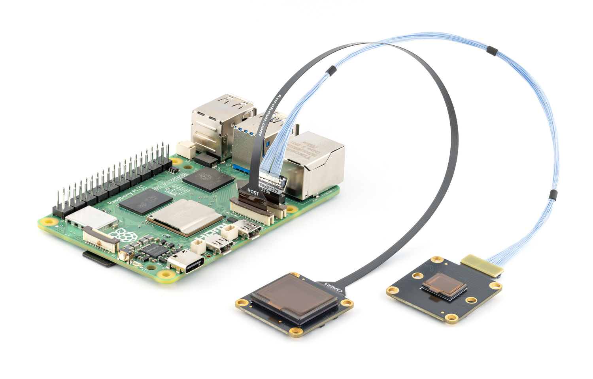

# IMX462 camera setup on Raspberry Pi

[](https://github.com/raspberrypi/linux/blob/rpi-6.18.y/drivers/media/i2c/imx290.c)
[](https://www.raspberrypi.com/software/operating-systems/)
[](https://github.com/raspberrypi/linux/tree/rpi-6.6.y)

Raspberry Pi setup for Sony IMX462, a 2 MP 1/2.8" STARVIS low-light CMOS sensor with 2.9 µm pixels. Raspberry Pi OS supports it out of the box with `imx290` family driver.

- 2-lane and 4-lane MIPI CSI-2 (up to 891 Mbps/lane)
- 10-bit and 12-bit RAW output
- 1920×1080 @ 60 fps (full resolution)
- 1280×720 @ 60 fps (sensor crop)
- Color and mono variants
- HCG mode via module parameter



*IMX462 camera modules are available at [kurokesu.com](https://www.kurokesu.com/item/462C-CSI)*

## Setup

Connect camera to CSI port with Pi powered off.

Update OS and reboot:

```bash
sudo apt update && sudo apt full-upgrade -y
sudo reboot
```

Edit boot configuration:

```bash
sudo nano /boot/firmware/config.txt
```

Make two changes:

1. Find `camera_auto_detect` near the top and set it to `0`:

```ini
camera_auto_detect=0
```

2. Add `dtoverlay=imx462` under the `[all]` section at the bottom of the file:

```ini
[all]
dtoverlay=imx462
```

*If camera is connected to cam0 port, use `dtoverlay=imx462,cam0` instead. See [cam0](#cam0).*

Save and exit.

`config.txt` changes take effect after reboot:

```bash
sudo reboot
```

Verify camera is detected:

```bash
rpicam-hello --list-cameras
```

Expected output:

```
[verify] paste fresh rpicam-hello --list-cameras output here
```

*Output shown for cam1 port on Pi 5.* [verify]

Start live preview:

```bash
rpicam-hello -t 0
```

On headless systems, capture a still image instead:

```bash
rpicam-still -o test.jpg
```

## Driver

IMX462 runs on `imx290` family driver, which also covers IMX290 and IMX327. Camera tools list sensor as `imx462`, while kernel log and module parameters use driver name `imx290`.

## dtoverlay options

`imx462` overlay supports comma-separated options to override defaults:

| option | description | default |
|--------|-------------|---------|
| [`cam0`](#cam0) | Use cam0 port instead of cam1 | cam1 |
| [`4lane`](#4lane) | Use 4-lane MIPI CSI-2 (if wired) | 2 lanes |
| [`clock-frequency=<Hz>`](#clock-frequency) | Sensor input clock (Hz) | 37125000 |
| [`mono`](#mono) | Mono sensor variant | color |
| `rotation=<deg>` | Sensor mounting rotation | 0 |
| `orientation=<n>` | Camera orientation (0 front, 1 back, 2 external) | 2 |
| `media-controller=0` | Use legacy unicam driver | on |

### cam0

If camera is connected to cam0 port, append `,cam0`:

```ini
dtoverlay=imx462,cam0
```

### 4lane

To enable 4-lane MIPI CSI-2, append `,4lane`:

```ini
dtoverlay=imx462,4lane
```

> [!WARNING]
> Before using `4lane`, confirm your camera port actually supports 4-lane MIPI CSI. Not all Raspberry Pi models and carrier boards provide 4-lane MIPI CSI on both ports.

4 lanes halve link frequency. Modes and framerates stay the same, see [Output formats](#output-formats).

### clock-frequency

Kurokesu IMX462 modules carry a 37.125 MHz oscillator, which matches overlay default.

Driver accepts 37.125 MHz or 74.25 MHz only. Any other value fails at probe with `External clock frequency ... is not supported`.

### mono

For mono modules, append `,mono`:

```ini
dtoverlay=imx462,mono
```

Mono modules output `Y10` and `Y12` greyscale formats instead of Bayer.

> [!TIP]
> Options can be combined. Example (cam0, 4-lane, mono):
>
> ```ini
> dtoverlay=imx462,cam0,4lane,mono
> ```

## Output formats

| Link frequency | Data rate / lane | Lanes | Bit depth | Width | Height | Max FPS |
|---|---|---|---|---|---|---|
| **1280×720 (sensor crop)** | | | | | | |
| 148.5 MHz | 297 Mbps | 4 | 10-bit | 1280 | 720 | [verify] |
| 148.5 MHz | 297 Mbps | 4 | 12-bit | 1280 | 720 | [verify] |
| 297 MHz | 594 Mbps | 2 | 10-bit | 1280 | 720 | [verify] |
| 297 MHz | 594 Mbps | 2 | 12-bit | 1280 | 720 | [verify] |
| **1920×1080 (full resolution)** | | | | | | |
| 222.75 MHz | 445.5 Mbps | 4 | 10-bit | 1920 | 1080 | [verify] |
| 222.75 MHz | 445.5 Mbps | 4 | 12-bit | 1920 | 1080 | [verify] |
| 445.5 MHz | 891 Mbps | 2 | 10-bit | 1920 | 1080 | [verify] |
| 445.5 MHz | 891 Mbps | 2 | 12-bit | 1920 | 1080 | [verify] |

Driver selects link frequency from mode and lane count.

## HCG mode

High conversion gain (HCG) is set via module parameter. New value applies at next stream start:

```bash
# 0=off, 1=on
echo 1 | sudo tee /sys/module/imx290/parameters/hcg_mode
```

> [!NOTE]
> Module parameter is global: it applies to all sensors on `imx290` driver, including IMX290 and IMX327.

## FAQ

### Why does rpicam-hello say "No cameras available!"?

Check [Setup](#setup) steps first: `camera_auto_detect=0`, overlay line under `[all]` and `cam0` option matching the port in use. Then check kernel log:

```bash
dmesg | grep imx290
```

`Could not initialize device` means sensor does not answer on I2C. Check camera port and cable seating, with Pi powered off.

`Could not create camera helper for imx462` means libcamera predates IMX462 support. Update OS as shown in [Setup](#setup).

## Credits

- FRAMOS and [Manivannan Sadhasivam](https://github.com/Mani-Sadhasivam) (Linaro) for original [imx290 driver](https://github.com/raspberrypi/linux/blob/rpi-6.18.y/drivers/media/i2c/imx290.c)
- [Dave Stevenson](https://github.com/6by9) of Raspberry Pi for IMX462 support in driver and [imx462 overlay](https://github.com/raspberrypi/linux/blob/rpi-6.18.y/arch/arm/boot/dts/overlays/imx462-overlay.dts)
- [geoffrey-vl](https://github.com/geoffrey-vl) for libcamera IMX462 helper and tuning ([raspberrypi/libcamera#207](https://github.com/raspberrypi/libcamera/pull/207))
